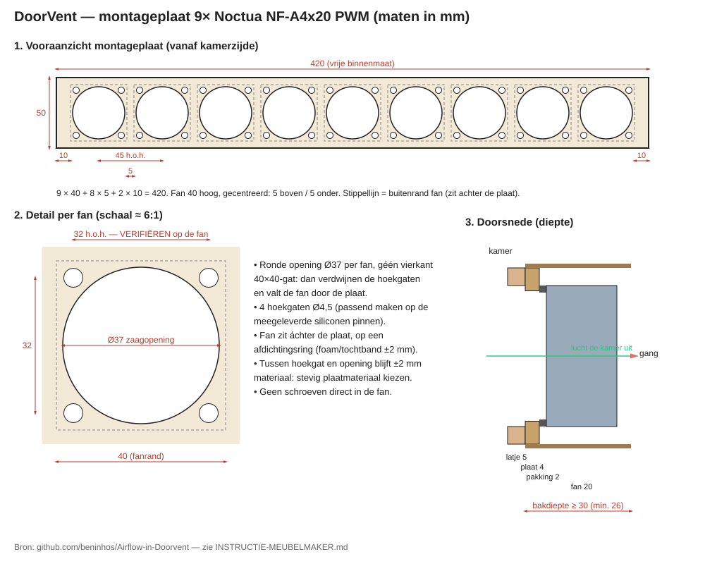

# Instructie meubelmaker — fanbak in het bovenpaneel

Tekening: [tekeningen/montageplaat.svg](tekeningen/montageplaat.svg) · Opdracht als Word-bestand: [Opdracht-meubelmaker-fanframe.docx](Opdracht-meubelmaker-fanframe.docx)

## Wat er komt

In het vaste paneel boven de slaapkamerdeur zit nu het DUCO DoorVent-rooster in een gefreesd gat van **420 × 50 mm**. Dat rooster gaat eruit. In hetzelfde gat komt een houten bak met daarin een losse montageplaat met 9 kleine ventilatoren (Noctua NF-A4x20 PWM, 40 × 40 × 20 mm). Ze blazen lucht de kamer uit; verse lucht komt onder de deur door binnen. Er komt dus géén tweede opening ernaast.

## Vóór het zagen: eerst controleren

1. **Hoekgaten op de fan opmeten.** De tekening gaat uit van 32 mm hart-op-hart. Meet dit na op een echte fan.
2. **Siliconen pinnen passen.** Boor een proefgat (Ø4,5) in een restje van het plaatmateriaal en kijk of de meegeleverde pin er goed in klemt. Pas de gatmaat zo nodig aan. De pinnen zijn gemaakt voor dunne pc-kastwanden: krijg je ze niet door de plaat, verdiep de gaatjes dan aan de achterkant of kies dunner materiaal.
3. **Binnenmaat.** Frame en latje mogen over de rand van het paneel vallen; wat telt is dat er binnenin **420 × 50 mm vrij** blijft voor de 9 fans. Details stemmen we af als je langskomt.

## Onderdelen

**Houten bak**
- Vrije binnenmaat 420 × 50 mm.
- Diepte minimaal 26 mm achter het latje, liever **30 mm of meer** (ruimte voor kabels en speling).
- Aan beide kanten open: kamerzijde via de montageplaat met fanopeningen, gangkant helemaal open.

**Montageplaat**
- Plaatdikte 3–4 mm, stevig materiaal (bijv. multiplex of hardboard; geen zacht MDF, zie hieronder).
- Buitenmaat: passend in de bak (420 × 50 mm).
- Per fan een **ronde opening Ø37 mm**, géén vierkant gat van 40 × 40. Bij een vierkant gat verdwijnen de hoekgaten en valt de fan door de plaat.
- Per fan 4 hoekgaten Ø4,5 mm op 32 × 32 mm.
- Tussen hoekgat en ronde opening blijft maar ±2 mm materiaal over. Daarom stevig plaatmateriaal.
- Layout over de breedte: 10 mm marge links, fans op 45 mm hart-op-hart (5 mm tussenruimte), 10 mm marge rechts. Middelpunt eerste fan op 30 mm van de rand, daarna steeds +45 mm (30, 75, 120 … 390).
- Hoogte: middelpunten op 25 mm (midden van de 50 mm).
- **Losneembaar** monteren (bijv. 2 schroefjes aan de uiteinden), zodat fans later te vervangen zijn.

**Afwerklatje (kamerzijde)**
- Dun sierlatje ±5 mm dik, rondom de opening.
- Mag aan boven- en onderkant maximaal 5 mm over de opening steken, anders dekt het de luchtgaten af.

## Montage

1. Op de achterkant van de montageplaat rond elke opening een ring afdichtingsband (foam/tochtband, ±2 mm) plakken. Die zorgt dat de lucht door de fan gaat en niet langs de fan lekt.
2. Fans achter de plaat zetten met de meegeleverde **siliconen pinnen**. Niet rechtstreeks vastschroeven: dan brommen ze via het hout.
3. **Alle 9 fans dezelfde kant op**: de pijl op de fan wijst de kamer uit (naar de gang).
4. Kabels aan de achterkant langs naar één kant van de bak leiden.
5. Plaat in de bak, latje ervoor.

## Nog af te stemmen met Rutger

- **Kabeldoorvoer:** waar de kabels uit de bak naar het verdeelkastje (fan-hub) gaan. Plek en gatmaat (±10 mm) nog bepalen.
- Of de gangkant een roostertje of afdekking krijgt.

## Samenvatting maten

| Wat | Maat |
|---|---|
| Vrije binnenmaat bak | 420 × 50 mm |
| Bakdiepte achter latje | min. 26, liefst ≥ 30 mm |
| Montageplaat | 3–4 mm dik |
| Opening per fan | Ø37 mm, 9 stuks |
| Hart-op-hart fans | 45 mm, eerste op 30 mm |
| Hoekgaten | Ø4,5 op 32 × 32 mm (verifiëren) |
| Afdichtingsband | ±2 mm |
| Fan | 40 × 40 × 20 mm |
